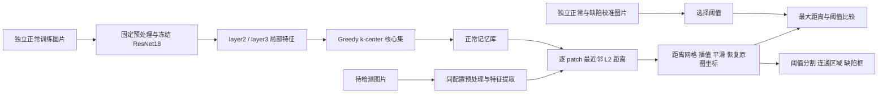

# PatchCore 采样、热力图与漏检评估

本页说明本项目的具体实现和可复现实验。合成场景用于验证算法行为、发现敏感条件；其漏检率和误检率不能当作真实产线准确率。运行数据、阈值与配置选择记录保存在 `output/patchcore-evaluation/`，真实图片可通过文末 manifest 接入同一评估流程。

本轮证据支持保留默认224配置和10%采样起点，增加独立阈值校准及可评估的预处理选项。补充1%稀疏库对照中，训练启发式阈值漏检41/180；校准召回优先阈值后漏检10/180，同时正常误报从0/40升至7/40。详细条件及局限见第6节，不能将这个改善外推为默认模型或真实产线的收益。

## 1. 建库与检测流程



建库不更新网络参数，只提取正常图片的特征并选取代表性向量，因此不需要缺陷训练标签。为了选择业务判定阈值，本项目另外使用有正常/缺陷标签的校准集；这一步不改变无监督建库的性质。

本项目采用轻量 ResNet18，使用热力图最大值作为图像分数。它与论文常见 WideResNet50 配置及论文加权图像分数并不完全相同，因此不能直接套用论文准确率。方法背景见 [PatchCore 原始论文](https://arxiv.org/abs/2106.08265) 与 [作者实现](https://github.com/amazon-science/patchcore-inspection)。

## 2. 特征子集和记忆库是如何形成的

实际实现位于 `services/agent-service/app/vision/algorithms.py`。

1. RGB 图片按保存的配置缩放，使用 ImageNet 均值、标准差归一化；骨干网络固定为推理模式。
2. 取 ResNet18 的 `layer2` 和 `layer3`。224 输入时分别为 `128×28×28`、`256×14×14`；448 输入时空间尺寸翻倍。
3. 两层分别做 `3×3、stride=1` 平均池化，聚合相邻纹理；将 layer3 双线性插值到 layer2 的网格，再沿通道拼接。每个位置得到 **384 维向量**。
4. 汇总所有正常图片的 patch。letterbox 模式只让中心位于真实图像内容内的 patch 参与建库，排除纯补边位置；边缘 patch 的感受野仍可能跨入补边，不能认为补边影响完全消失。
5. 使用下面的核心集采样，最终保留原始向量组成记忆库。

浅中层保留较高空间分辨率，适合局部纹理和结构差异。最后层的语义更强、空间网格更粗，小划痕等信息可能被下采样或分类不变性削弱；选择中间层是兼顾局部细节与语义的设计，并非保证所有产品都最优。

令全部正常向量为 `F={f₁,…,fN}`，默认采样比例 `r=0.1`，实际容量：

`K = min(1024, max(1, ceil(N × r)))`。

本实现用固定种子 0 的高斯矩阵，将 384 维暂时投影到 64 维，得到 `zᵢ`，仅用于选择索引。初始点为距离全体投影均值最远的向量，随后维护：

`dᵢ = min(‖zᵢ − zⱼ‖²，j 属于已选集合 S)`

每轮选 `argmax(dᵢ)` 加入 S，再用新点更新各向量的最近距离，直到选够 K 个不重复索引。它是近似覆盖正常外观的贪心过程，不是随机抽样，也不是 K-means；推理时仍比较选中的 **384 维原始向量**，不会比较临时 64 维投影。

容量达到 1,024 后，增加分辨率或正常图片并不会等比例增加记忆库。应同时记录 `patch_count`、`memory_size` 和实际采样率，而不能只写“采样 10%”。过度压缩可能丢失少见正常外观，导致误报；正常库混入缺陷则可能让相似缺陷被匹配为正常、增加漏检。更大的库也不保证异常分离度更好。

## 3. 热力图生成与判定

对待测 patch 特征 q，先计算原始最近邻距离：

`a(q) = min(‖q − m‖₂，m 属于正常记忆库)`。

然后执行：

1. 按 patch 位置恢复成 `28×28` 或 `56×56` 距离网格。
2. 双线性插值到 224 或 448 的模型输入平面。
3. 做高斯平滑，σ 是**模型输入平面的像素单位**；σ=0 时跳过平滑。较大的平滑可能降低小缺陷峰值。
4. letterbox 模式先裁掉补边，再插值回原图大小，保持热图和框的坐标一致。
5. 图像分数 `s = max(A)`。本实现图像与像素共用阈值 t，`s ≥ t` 判为异常；像素掩码为 `A ≥ t`，做 8 邻域连通区域，最多显示面积最大的 100 个框，不额外删除小面积区域。

颜色显示使用 `clip(A/t × 127.5, 0, 255)` 后应用 TURBO 色表，叠加透明度为 0.42。**判定基于原始距离，颜色不是概率。** 本实现不对每张图做 min-max 拉伸，避免正常图也被强制画出最高异常颜色；但不同阈值、预处理或模型的颜色仍不宜直接比较。实验对照应使用相同色标并同时阅读原始分数。

平滑、骨干感受野和网格插值会扩散异常响应；“整图检出”不等于“准确定位到真实缺陷”。本轮主指标为图像级 FNR/FPR，合成掩码用于检查缺陷位置，未用它们宣称像素分割精度。

## 4. 阈值的统计口径

| 指标 | 计算方法 | 含义 |
| --- | --- | --- |
| 漏检率 FNR | `FN / (TP + FN)` | 真正有缺陷的图片中，有多少未被报出 |
| 召回率 Recall | `TP / (TP + FN) = 1 − FNR` | 真正有缺陷的图片中，有多少被报出 |
| 误检率 FPR | `FP / (FP + TN)` | 真正正常的图片中，有多少被误报 |
| 精确率 Precision | `TP / (TP + FP)` | 报异常图片中，真正有缺陷的比例；无阳性预测时为空 |

分母必须分开。`FP/(TP+FP)` 是误报占报警的比例，不是本报告定义的 FPR。合成缺陷占比是人为设计的，不能用本轮精确率预测产线报警负担。

阈值候选来自校准分数的决策边界，比较规则统一为 `score ≥ threshold`，保留等于阈值时的异常判定。策略如下：

| 策略 | 校准目标 | 使用边界 |
| --- | --- | --- |
| 召回优先 | 最小化 `5 × FNR + FPR`；同成本优先低漏检 | 5 是可解释的实验代价权重，不能替代真实漏检损失与返检成本 |
| 平衡 | 最小化 `FNR + FPR`；同成本优先低误检 | 对两个类别的错误率等权，而不是对样本总错误数等权 |
| 校准集零误报 | 取严格大于正常校准最大分数的最小可表示浮点数 | 保证校准正常样本 FP=0；不保证独立测试或后续生产 FP=0 |

新建库从训练特征中最多均匀取2,048个patch，使用最近邻距离 `max(0.001, P99 × 1.2)` 作为启发式起点：训练图片参与过建库、patch分数也不同于整图最大值，不能充当验证集阈值。改进后页面可上传独立正常/缺陷图片，计算上述策略并保存阈值及校准指标。手动阈值仍可设置。

## 5. 已实现的图像预处理选项

| 配置 | 作用与需要验证的风险 |
| --- | --- |
| 224 / 448 输入 | 448 保留更多空间采样，计算量和特征数也增加；库容量上限可能改变有效覆盖率 |
| stretch | 拉伸到正方形；非正方形产品的形状会被改变，但新旧实现保持兼容 |
| letterbox | 等比缩放，复制边缘像素补齐；恢复热图坐标时去掉补边 |
| CLAHE / none | CLAHE 在缩放后的 LAB 亮度 L 通道操作，clip=2、网格8×8；可能增强弱缺陷，也可能增强噪声和反光 |
| σ=0…8 | 控制距离图平滑；较小 σ 可能保留微小异常峰，也可能产生更多局部误报 |

直方图均衡化依据灰度累计分布重新映射亮度。CLAHE 在局部区域做带裁剪的均衡化，并通过插值减少区域接缝；裁剪限制对比度增益。它无法恢复曝光饱和或缩放时已经丢失的细节，不应一律开启。[OpenCV 官方说明](https://docs.opencv.org/4.13.0/d5/daf/tutorial_py_histogram_equalization.html)

每个记忆库保存配置，检测和校准都自动读取它；更换配置需要重新建库和校准。旧库缺少配置时保持 224/stretch/none/σ4 的行为。旧库若缺少建库图片摘要，需要重新建库后才能使用自动校准，以检查训练与校准重叠。

## 6. 实验协议与结果文件

固定种子 20261019，正常建库 12 张，校准 24 张正常 + 每种缺陷 8 张，独立测试 40 张正常 + 每种缺陷 20 张，共 328 张。九类场景为明显划痕、细划痕、针孔、低对比度缺陷、边缘缺损、模糊细划痕、低照度缺陷、反光缺陷、位置异常。正常样本也包含相应光照、模糊、纹理和位置变化，避免仅凭环境变化区分缺陷。

五组预先声明的配置比较分辨率、缩放、CLAHE 和 σ；所有配置完成校准并写入 `selection_locked.json` 后，才运行最终测试。建议配置由校准目标选出，测试只用于评价这些预先声明的对照；不根据测试结果反向调阈值。数据验证检查文件摘要、规范化 RGB 摘要及可选 `group_id`，真实数据须将同一实物或批次的相关图片放在同一分区。

| 输出 | 内容 |
| --- | --- |
| `dataset/manifest.csv` | 合成图片、标签、分区与掩码清单 |
| `preregistered_plan.json` | 参数、随机种子、权重/源码 SHA256、运行库版本 |
| `selection_locked.json` | 在测试前锁定的配置和阈值 |
| `scores.csv` | 每张图的原始分数、标签、场景与摘要 |
| `threshold_sweep.csv` | 校准集阈值扫描与对应错误率 |
| `summary.json` / `test_comparison.csv` | 总体、分场景结果及分母 |
| `scenario_fnr.png` / `score_distributions.png` | 漏检场景对照、分数与阈值分布 |
| `ablation_scenario_fnr.png` | 五组配置的分场景漏检与正常误报对照 |
| `synthetic_examples.png` | 原图、注入掩码、热图对照 |
| `independent-audit.json` / `.md` | 独立重算的混淆矩阵、域分层和口径审计 |

### 6.1 本次独立测试结果

以下每行均使用**各自校准集选出的召回优先阈值**，测试为180张缺陷、40张正常；阈值只是本次特征库的原始距离，不能复制到其他记忆库。

| 配置 | 原始阈值 | 漏检 / 缺陷 | FNR | 误报 / 正常 | FPR |
| --- | ---: | ---: | ---: | ---: | ---: |
| 224 stretch，无CLAHE，σ4（校准选中） | 1.255887 | 0/180 | 0% | 0/40 | 0% |
| 224 stretch，无CLAHE，σ2 | 1.319329 | 0/180 | 0% | 0/40 | 0% |
| 448 stretch，无CLAHE，σ2 | 1.732113 | 17/180 | 9.44% | 0/40 | 0% |
| 448 letterbox，无CLAHE，σ2 | 1.130452 | 0/180 | 0% | 12/40 | 30% |
| 448 letterbox，CLAHE，σ2 | 1.523618 | 15/180 | 8.33% | 1/40 | 2.5% |

**高漏检场景与配置相关，不能脱离阈值作泛化结论。** 448 stretch 下，位置异常漏检15/20（75%）、低对比度漏检2/20（10%）；其余七类在该阈值下没有漏检。448 letterbox + CLAHE 的15个漏检均为位置异常。局部图案仍能找到相似正常 patch，是位置约束可能值得补充的线索；但本生成器的移位也会带来纹理接缝，尚不能证明纯逻辑异常的性能或唯一失效原因。

同一个448 letterbox库的阈值权衡更直接：平衡策略阈值1.636261时，漏检16/180（8.89%）、误报0/40；召回优先阈值1.130452时，漏检0/180、误报12/40（30%）。两个阈值都在测试前从校准集选出。阈值降低换来了更多召回和更多返检，这并非同时提升两项指标。

“校准集零误报”在448 stretch的独立测试上仍误报1/40，在448 letterbox上误报2/40，直接说明零误报标签不能外推到新数据。此外，完全分离的校准样本中，多种阈值都可能零误差；因此三种策略的阈值大小不必始终按策略名称排序。

本轮没有暴露224基线的漏检：训练启发式阈值1.065566、独立校准阈值1.255887在这批测试上都是0FN/0FP，不能声称校准已经降低基线漏检率。0/180漏检对应的描述性95% Wilson区间约为0%–2.09%，0/40误报对应0%–8.76%；程序生成样本并不代表独立生产批次，这些区间也不是产线保证。

### 6.2 根据证据采取的调整

- **保留默认224/stretch/none/σ4。** 它由校准规则选中，测试没有提供全局启用448或CLAHE的理由。新增参数可按产品评估后选择，旧库数值行为保持一致。
- **将独立校准落到实际操作。** 页面现在计算三种策略、保存阈值和统计分母，并拒绝完全重复的训练/校准图片；不再只能依赖训练patch的启发式建议。手动调整仍可用，但已保存校准指标不自动适用于新的手动阈值。
- **为高漏检场景保留后续验证方向。** 位置异常考虑固定ROI/空间对应约束、部件数量与装配位置规则；低对比度先检查照明、曝光、ROI与特征覆盖，再比较CLAHE和分辨率。上述方向尚未在真实图片上证实，不能写成已解决。
- **控制内存和配置漂移。** 建库逐张解码并释放原图；每库记录预处理配置，推理读回该配置。letterbox排除补边中心的建库特征，并将热图正确映射回原图。

需同时披露资源因素：224共有9,408个训练patch，保存941个（10.00%）；448 stretch共有37,632个，保存1,024个（2.72%）；448 letterbox共有23,520个内容patch，保存1,024个（4.35%）。这些是**相同1,024容量上限下的系统配置对照**，不能把差异仅归因于输入分辨率。正常与缺陷的环境域混合比例也不完全相同，域内错误率需另读分层审计，不能只凭总体数字判断照明鲁棒性。

运行使用官方ResNet18权重，SHA256为 `f37072fd47e89c5e827621c5baffa7500819f7896bbacec160b1a16c560e07ec`。本轮完整主实验用时约391秒；环境、源码与数据摘要见原始JSON，运行源码保存在 `source_snapshot/`。σ2配置复用了σ4建库特征，原 `fit_metadata` 中的σ4表示建库元数据来源，实际评分配置以外层 `config` / `evaluation_config` 为准；σ不影响特征或采样，只影响热图平滑。

### 6.3 补充：记忆库1%采样消融

在相同224/stretch/none/σ4下，将请求采样率从10%降到1%，记忆特征由941个降为95个，实际比例95/9,408≈1.01%。仍使用同一份训练、校准和测试清单，manifest SHA完全一致。完整结果位于 `coreset001/`。

| 稀疏库阈值策略 | 阈值 | 漏检 / 180 | FNR | 误报 / 40 | FPR |
| --- | ---: | ---: | ---: | ---: | ---: |
| 训练启发式 | 1.992725 | 41 | 22.78% | 0 | 0% |
| 独立校准：召回优先 | 1.674712 | 10 | 5.56% | 7 | 17.5% |
| 独立校准：平衡 | 1.711753 | 14 | 7.78% | 1 | 2.5% |
| 独立校准：校准集零误报 | 1.705180 | 12 | 6.67% | 1 | 2.5% |

训练启发式下，高漏检场景为位置异常15/20（75%）、针孔15/20（75%）、低对比度11/20（55%）。召回优先校准后，位置异常仍漏10/20（50%），针孔和低对比度在这20张各自样本中不再漏检，正常误报则增加至7张。过度压缩改变了正常覆盖和距离分布，同时抬高本例训练启发式阈值；不能仅调整采样率而沿用未经验证的阈值。

这组是补充采样消融，复用了主实验测试集，不构成另一份新的独立确认性证据，也不用于重新选择主配置。它支持“压缩库后重新校准并同时检查FNR/FPR”的工程操作，不支持“所有产品采样10%一定优于1%”的普遍结论。

重跑该对照可明确标注合成来源：

```powershell
.\.venv\Scripts\python.exe scripts/evaluate_patchcore.py --manifest output/patchcore-evaluation/dataset/manifest.csv --data-kind synthetic --include-small-coreset --configs 224_stretch_sigma4_coreset001 --output output/patchcore-coreset-new
```

## 7. 接入真实数据与复跑

在项目根目录，用已安装视觉依赖的 Python 环境运行；权重路径由运行者明确指定。输出目录应使用新目录，避免覆盖上一次实验。

```powershell
.\.venv\Scripts\python.exe scripts/evaluate_patchcore.py --synthetic --weights .runtime/quality-vision-validation/resnet18-f37072fd.pth --output output/patchcore-evaluation-new
.\.venv\Scripts\python.exe scripts/evaluate_patchcore.py --manifest L:/data/quality/manifest.csv --weights L:/models/resnet18-f37072fd.pth --output output/patchcore-real-evaluation
```

真实 manifest 支持 CSV 或 JSON 数组。相对路径相对于 manifest 所在目录解析，必填列为 `split,label,scenario,path`，可选 `mask_path,group_id`。训练只允许 normal，calibration/test 均须有正常和缺陷图片。

```csv
split,label,scenario,path,mask_path,group_id
train,normal,normal,images/train_001.png,,part_train_001
calibration,normal,normal,images/cal_normal_001.png,,part_cal_001
calibration,defect,fine_scratch,images/cal_defect_001.png,masks/cal_defect_001.png,part_cal_002
test,normal,normal,images/test_normal_001.png,,part_test_001
test,defect,fine_scratch,images/test_defect_001.png,masks/test_defect_001.png,part_test_002
```

模板仅演示格式，样本量不足以证明生产可靠性。真实评估应按产品、批次、相机与拍摄日期分组，保留足够的小缺陷、边缘、弱对比度和异常光照样本，并补充定位指标与推理时延。哈希检查只能识别完全相同的内容，不能自动发现同一工件不同照片的关联。

页面入口：质检 → 视觉缺陷检测 → 新建正常记忆库时选择预处理 → 使用独立图片校准阈值 → 另取测试图片检测。在线校准合计最多24张；离线评估入口支持更大的校准/测试集，训练库仍有24张与1,024特征容量限制。

若真实数据中出现“常见局部纹理放错位置、部件数量不对”等逻辑异常，仅用无位置约束的局部最近邻可能不足。可增加 ROI/位置约束和装配规则；已有稳定缺陷标注时，可比较现有 YOLO 缺陷分支的检测结果。两种算法应分别验证，再决定如何组合报警，不能凭合成测试宣称已解决。
